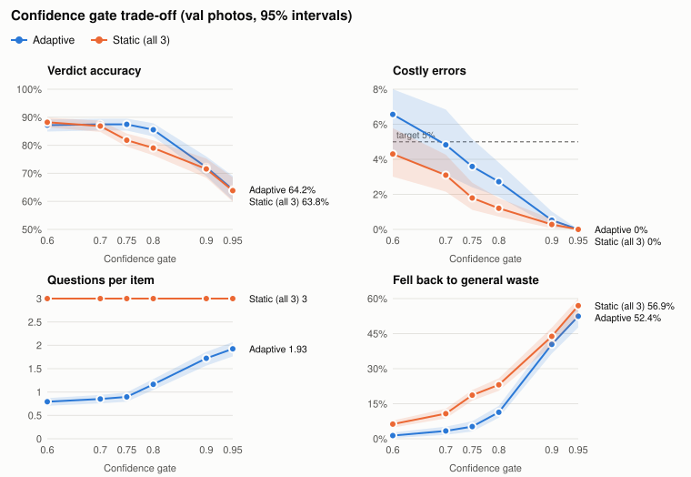
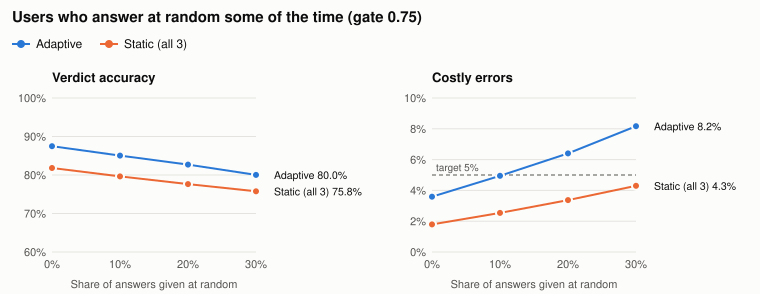
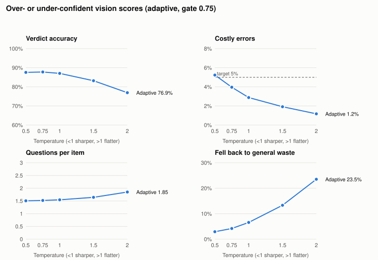

# WS3 analysis report: how well the adaptive questions and the confidence gate work

**Author:** Baral Diwash (WS3 Ask and Decide) · **Date:** 21 Oct 2026 · **Branch:** `ws3/decision-analysis`
**Every number below** is in [`ws3_analysis/results.json`](ws3_analysis/results.json) and
[`ws3_analysis/tables.md`](ws3_analysis/tables.md), produced by `scripts/analyse_decisions.py`
(see "Reproduce" at the end).

## Summary

1. **Recommended gate: 0.75** (it was 0.80, PROVISIONAL; my earlier note proposed 0.70). Against 0.80 it is
   1.8 points more accurate (95% interval +1.1 to +2.6), asks 0.09 fewer questions and falls back to
   general waste on 6.6% of items instead of 11.0%. Its costly-error rate is 2.9%, within the 5% target.
   0.70 is no more accurate than 0.75 (+0.4 points, interval −0.2 to +1.1) but makes 1.0 point more
   costly errors, and it breaks the target as soon as 10% of answers are careless.
2. **Adaptive beats the static questionnaire** (proposal baseline 2). At the same gate it asks
   1.54 questions instead of 3, with 87.0% accuracy against 81.8%. The held-out test split confirms
   this: 86.5% against 80.7%.
3. **D-003 matters.** D-003 is the rule "a recyclable item always gets the rinse question". Without
   it, at a 0.70 gate, 97% of items get no questions and every recyclable of unknown cleanliness goes
   to general waste, so accuracy falls to 65%. Choosing questions by expected entropy reduction always
   picked the better order; a fixed Q3-first order loses 6 points at a 0.80 gate.
4. **The flow is robust within limits.** At 0.75 the costly-error target holds:
   - with up to about 15% random answers;
   - in every one of 20 worlds where users' answer tables differ moderately from ours;
   - for any share of clean items from 30% to 70%.
5. **The confidence Bin Buddy shows can be trusted.** When it says 80–90% sure, it is right 85.8% of
   the time; the expected calibration error (ECE) is 0.026. **Over-confident vision scores are the
   real danger.** Sharpening them (temperature 0.5) pushes costly errors above 5%. WS2's calibration
   therefore protects WS3's safety target.
6. **Styrofoam is the weak spot:** 10.7% of styrofoam runs are costly errors (7 photos), because it
   is misread as plastic and carries a recycling symbol.

**Limitation that applies to everything above:** the photos have no recorded Q1–Q3 answers, so the
true cleanliness and the user's answers are **simulated**. Analyses 3, 4 and 9 deliberately make the
simulated users disagree with the tables the flow uses, to test how much this matters.

## What WS3 built (work log)

| Date (2026) | Work | Commit |
|---|---|---|
| 18 Oct | Naive-Bayes belief update, entropy-based next question, bin-level confidence gate, D-003 and e-waste safety rules | `051d9dc` |
| 18 Oct | Plain-English rule traces ("How Bin Buddy decided"); verdict follows the most likely bin | `9c65624` |
| 18 Oct | Proposal baseline 2: static questionnaire (`--system static`) | `8c67e3a` |
| 19 Oct | Likelihood counting from recorded answers (`estimate_likelihoods.py`), WS3 docs | `aa74bb9` |
| 19 Oct | Gate sweep on the team's own photos (`simulate_gate.py --source local`) | `b4f1cd9` |
| 19 Oct | Fix: fallback verdict shows the confidence of the bin it recommends; team report | `7393a73` |
| 19 Oct | Copilot review fixes (e-waste rule, likelihood floor, costly-error definition); merged as PR #13 | `deb7826` |
| 21 Oct | **This report:** 9 analyses, bootstrap intervals, held-out check, ablation switches, SVG figures, tests | this branch |

Also WS3: `policies/hdb_default.yaml` checked against NEA guidance and `campus_example.yaml`
completed as the multi-stream site.

## Method

- **Photos:** the team's own local photos from WS1's `predictions.csv` (model `v0.2-local-data`,
  ConvNeXt-T, temperature-calibrated): **247 validation photos (179 physical items)** for tuning
  and **395 test photos (287 items)** checked once at the end.
- **Simulated users:** 20 per photo. Each draws a true condition (50% clean, otherwise one of the
  three contaminated conditions) and Q1–Q3 answers from the likelihood tables. Every setting sees
  the same draws.
- **The real flow:** each run goes through the actual `app/decision.py` code that serves `/predict`
  and `/answer`, not a copy of it.
- **Metrics (proposal Section 9):**
  - average questions per item;
  - share of items answered with no questions;
  - verdict accuracy (against the HDB policy's bin for the true material and condition);
  - **costly-error rate**: of the items whose true bin is not the blue bin, the share sent to it
    (the same definition as `scripts/evaluate_baselines.py`);
  - share of items that fell back to general waste.
- **Uncertainty:** 95% bootstrap intervals with 1,000 resamples, **resampling physical items, not
  photos**, because photos of one item are not independent. Comparisons between settings are
  paired: the same resampled items for both.

## 1. Which confidence gate? (threshold trade-off)



| Gate (adaptive) | Avg questions | Accuracy | Costly errors | Fallback |
|---|---|---|---|---|
| 0.60 | 1.49 | 88.0% (86.1–89.8) | 4.5% (3.1–6.1) | 2.7% |
| 0.70 | 1.51 | 87.5% (85.5–89.4) | 3.8% (2.6–5.3) | 4.0% |
| **0.75** | **1.54** | **87.0% (84.9–89.1)** | **2.9% (2.0–3.9)** | **6.6%** |
| 0.80 (current) | 1.63 | 85.2% (82.9–87.5) | 2.4% (1.8–3.2) | 11.0% |
| 0.90 | 2.06 | 71.9% (68.7–75.6) | 0.3% (0.1–0.6) | 42.3% |
| 0.95 | 2.17 | 64.2% (60.2–69.1) | 0.0% | 54.8% |

| Paired comparison | Accuracy | Costly errors | Questions |
|---|---|---|---|
| 0.75 vs 0.80 | +1.8 (+1.1 to +2.6) | +0.5 (+0.2 to +0.8) | −0.09 |
| 0.70 vs 0.75 | +0.4 (−0.2 to +1.1) | +1.0 (+0.4 to +1.7) | −0.04 |
| adaptive 0.75 vs static 0.80 | +8.0 (+6.5 to +9.4) | +1.7 (+1.2 to +2.3) | −1.46 |

**Finding.** Raising the gate trades accuracy for safety. Above 0.80, most of the extra caution
becomes "general waste because unsure": the fallback rate reaches 42% at 0.90. Moving from 0.70 to
0.75 costs no measurable accuracy, but costly errors fall by a significant margin. Moving from 0.75
to 0.80 costs 1.8 points of accuracy for half a point fewer costly errors.

## 2. Does entropy-based question selection matter? (ablation)

`Gate` gained two switches, used only in analysis: D-003 on or off, and how the follow-up after Q1
is chosen (expected entropy reduction, or a fixed order).

| Variant | Gate | Avg questions | No questions | Accuracy | Costly errors |
|---|---|---|---|---|---|
| As designed (entropy, D-003 on) | 0.75 | 1.54 | 25.9% | 87.0% | 2.9% |
| Fixed order Q2→Q3, D-003 on | 0.75 | 1.54 | 25.9% | 87.0% | 2.9% |
| Fixed order Q3→Q2, D-003 on | 0.75 | 1.55 | 25.9% | 87.0% | 2.9% |
| Entropy, **D-003 off** | 0.70 | 0.05 | 96.8% | **65.4%** | 0.0% |
| Entropy, **D-003 off** | 0.75 | 0.82 | 42.5% | 70.5% | 0.6% |
| Entropy, D-003 off | 0.80 | 1.60 | 26.7% | 85.2% | 2.4% |
| Fixed order **Q3→Q2**, D-003 off | 0.80 | 1.92 | 26.7% | **79.0%** | 1.2% |

**Findings.**
- **D-003 is what keeps recyclables recyclable at lower gates.** The vision model cannot see
  cleanliness, so a plastic bottle starts at P(not clean) = 0.75 and therefore P(general waste) ≈ 0.75.
  Without D-003, a 0.70 gate settles that at once as general waste, with no questions.
  Costly errors look perfect (0%), but almost every clean recyclable is lost.
- **Entropy selection picks the better order by itself.** It matches the best fixed order (Q2
  first) and avoids the worse one, which loses 6.2 points at 0.80. With D-003 on, the order is mostly
  fixed anyway: Q1, then Q2 for recyclables, so only Q3 is left. No run followed Q1 → Q3. The
  observed paths at 0.75 were:

  | Path | Share of runs |
  |---|---|
  | Q1 → Q2 | 64.4% |
  | No questions | 25.9% |
  | Q1 → Q2 → Q3 | 8.0% |
  | Q1 only | 1.7% |

## 3. What if users answer carelessly? (answer noise)

Each answer is replaced by a random one with probability 0–30%. The flow still uses its own tables.



| Random answers | 0.70 costly | **0.75 costly** | 0.80 costly | 0.75 accuracy | Static 0.75 costly |
|---|---|---|---|---|---|
| 0% | 3.8% | **2.9%** | 2.4% | 87.0% | 1.8% |
| 10% | 5.3% ✗ | **4.1%** | 3.5% | 84.2% | 2.5% |
| 20% | 6.8% ✗ | **5.5%** ✗ | 4.7% | 81.5% | 3.4% |
| 30% | 8.4% ✗ | **7.1%** ✗ | 6.1% ✗ | 78.9% | 4.3% |

**Finding.** Each extra 10% of random answers costs about 2.7 points of accuracy and adds about 1.4
points of costly errors. 0.70 breaks the target at 10% noise, 0.75 at about 15–20% and 0.80 a
little above 20%. **This is why I now recommend 0.75 rather than 0.70.** The static questionnaire makes fewer
costly errors under noise, but at the price of 5 points of accuracy and about three times as many
fallbacks.

## 4. What if our answer tables are wrong? (misspecification)

Users follow **different tables** from the ones the flow uses: each cell is multiplied by
exp(N(0, σ)) and renormalised. This was run in 20 random worlds per σ.

| σ | Gate | Accuracy, mean (range) | Costly, mean (worst) | Worlds within 5% |
|---|---|---|---|---|
| 0.25 | 0.70 | 86.9% (84.4–89.5) | 4.0% (5.9%) | 90% |
| 0.25 | **0.75** | 86.2% (84.1–88.7) | 3.2% (4.7%) | **100%** |
| 0.25 | 0.80 | 84.5% (82.3–86.8) | 2.6% (3.8%) | 100% |
| 0.5 | 0.70 | 85.4% (80.4–90.0) | 4.4% (9.1%) | 70% |
| 0.5 | **0.75** | 84.7% (79.9–89.3) | 3.6% (7.7%) | **85%** |
| 0.5 | 0.80 | 83.0% (78.7–87.3) | 2.9% (6.2%) | 90% |

The other unknown is the share of clean items people bring:

| Clean items | 0.75 accuracy | 0.75 costly errors |
|---|---|---|
| 30% | 90.9% | 3.1% |
| 50% | 87.0% | 2.9% |
| 70% | 83.4% | 2.8% |

**Finding.** With moderately wrong tables (σ = 0.25, cells off by about ±25%), 0.75 stays within
the target in every world. With badly wrong tables (σ = 0.5) it does so in 85% of worlds. Costly
errors at 0.75 barely move with the share of clean items. The hand-set tables are therefore not a
single point of failure, but recording real answers (team decision 2) is still the way to remove
this uncertainty.

## 5. Calibration: can users trust the confidence shown?

**Inputs (WS1/WS2):**
- The vision material scores on these photos are close to calibrated: 81.4% top-1 accuracy at 82.6%
  mean confidence, ECE 0.044.

**Outputs (WS3), adaptive at 0.75 (ECE 0.026):**

| Confidence shown on the verdict | Runs | Mean shown | Actually right |
|---|---|---|---|
| 70–80% | 488 | 78.2% | 75.4% |
| 80–90% | 1,800 | 82.8% | 85.8% |
| 90–95% | 253 | 92.4% | 92.9% |
| 95–100% | 2,094 | 98.1% | 96.6% |

**What if the vision scores were over- or under-confident?** Each score p was raised to the power
1/T and renormalised:



| Temperature | Accuracy | Costly errors | Questions | Fallback |
|---|---|---|---|---|
| 0.5 (over-confident) | 87.6% | **5.2%** ✗ | 1.51 | 2.9% |
| 1.0 (as delivered) | 87.0% | 2.9% | 1.54 | 6.6% |
| 2.0 (under-confident) | 76.9% | 1.2% | 1.85 | 23.5% |

**Findings.**
- The confidence a verdict shows is honest: shown and actual agree within about 3 points in every
  well-populated band. Part of this agreement holds by construction, because the simulated answers
  follow the flow's own tables.
- **Over-confidence is the dangerous direction:** the gate passes items it should have asked about,
  and costly errors break the target. Under-confidence is only inefficient: more questions, more
  fallbacks.

## 6. Where do the questions and errors go? (per material, 0.75)

| Material | Photos | Avg questions | Accuracy | Costly errors |
|---|---|---|---|---|
| Plastic | 83 | 1.95 | 79.0% | 2.8% |
| Glass | 35 | 2.03 | 88.6% | 3.5% |
| Metal | 21 | 2.11 | 78.8% | 5.9% |
| Paper | 16 | 2.06 | 81.9% | 5.5% |
| Beverage carton | 15 | 2.05 | 89.0% | 3.8% |
| Styrofoam | 7 | 1.61 | 89.3% | **10.7%** |
| Other general | 40 | 0.72 | 98.0% | 2.0% |
| E-waste, textile, food waste | 30 | 0.00 | 100% | 0.0% |

**Findings.**
- All the questions go to recyclables (about 2 each, as D-003 intends). Items that go to the same
  bin whatever their condition get **none**, which is what keeps the average at 1.5.
- Styrofoam's costly errors come from photos the model reads as plastic: Q1 cannot fix this, because
  styrofoam often carries a recycling symbol (resin code 6). The fix belongs to the vision model (more
  styrofoam photos), not the questions.
- The sample is small (7 photos), so treat the styrofoam figure as a warning, not an estimate.

## 7. Held-out check (test split, checked once)

| System | Gate | Avg questions | Accuracy | Costly errors | Fallback |
|---|---|---|---|---|---|
| Adaptive | **0.75** | 1.62 (1.51–1.73) | 86.5% (84.8–88.0) | 2.6% (2.1–3.2) | 7.3% |
| Static | 0.75 | 3.00 | 80.7% (78.9–82.4) | 1.6% (1.2–2.1) | 19.2% |
| Adaptive | 0.80 | 1.73 (1.61–1.84) | 84.7% (82.9–86.5) | 2.2% (1.7–2.7) | 12.4% |

**Finding.** The test split agrees with validation: 86.5% against 87.0% accuracy, and 2.6% against
2.9% costly errors. So the gate was not overfitted to the validation photos.

## 8. A second site policy (multi-stream campus bins)

| System | Gate | Avg questions | Accuracy | Costly errors | Fallback |
|---|---|---|---|---|---|
| Adaptive | 0.75 | 1.60 | 81.9% | 2.4% | 11.8% |
| Static | 0.75 | 3.00 | 77.7% | 1.5% | 22.7% |

**Finding.** The same flow works unchanged on separate paper, plastic and cans/glass bins.
Accuracy is about 5 points lower than HDB because material mix-ups now change the bin (paper vs
plastic), whereas HDB's single blue bin absorbs them.

## 9. Should the flow assume more items are clean? (condition prior)

The flow starts every item at P(clean) = 0.25 (uniform over the four conditions). Would 0.50 be
better?

| Prior P(clean) | Accuracy | Costly errors | Fallback |
|---|---|---|---|
| **0.25 (current)** | 87.0% | **2.9%** | **6.6%** |
| 0.50 | 87.6% | 3.8% | 17.4% |

(Gate 0.75, 50% clean items; the same holds at 30% and 70%.)

**Finding.** Keep the uniform prior. A higher prior adds 0.6 points of accuracy but makes 0.9 points
more costly errors and nearly three times as many fallbacks. The reason is that "Not sure if it was
rinsed" settles as general waste under the current prior, but stays undecided under the higher one.
A data-driven prior would need cleanliness labels, which the dataset does not have.

## Decisions for the team

1. **Set `CONFIDENCE_THRESHOLD` to 0.75.** This replaces my earlier 0.70 proposal and is a contract
   change: version bump, changelog, and approval from WS3 and WS4.
2. **Record Q1–Q3 answers** when photographing items (unchanged). Analyses 3 and 4 show the flow
   tolerates moderate errors in the tables, but real answers remove the main limitation.
3. **WS1/WS2:** keep the material scores calibrated, never sharpened (analysis 5), and add styrofoam
   photos (analysis 6).

## Limitations

- **Simulated answers and conditions:** see the summary. This tests the decision logic and the gate,
  not the real accuracy of people's answers.
- **Same tables for users and flow:** in analyses 1, 2 and 5–9 the simulated users follow the
  flow's own tables. Analyses 3 and 4 relax this.
- **Small classes:** styrofoam (7 validation photos), food waste (4) and e-waste (11) are too small
  for firm per-material conclusions.
- **Correct out-of-distribution handling assumed:** the analysis uses material scores only, with no
  out-of-distribution abstention.

## Reproduce

```bash
# WS1 predictions: team Drive BinBuddy_Data/results/v0.2-local-data/predictions.csv (~3 minutes)
uv run python scripts/analyse_decisions.py --predictions <path>/predictions.csv \
    --out docs/workstreams/ws3_analysis
uv run pytest scripts/test_analyse_decisions.py services/inference/tests/test_decision.py
```

Defaults:
- `--source local`
- `--thresholds 0.6 0.7 0.75 0.8 0.9 0.95`
- `--repeats 20`
- `--clean-share 0.5`
- `--worlds 20`
- `--resamples 1000`
- `--seed 0`
